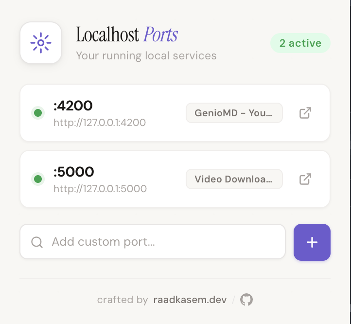
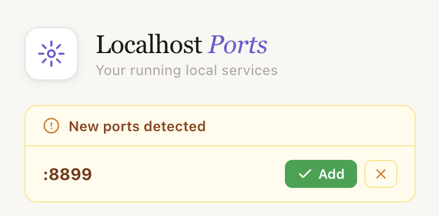

# Localhost Ports Dashboard


Chrome extension that checks selected local HTTP(S) ports and opens reachable services with one click.

**Current version: 1.2.1** · [Changelog](CHANGELOG.md)

## What's new in 1.2.1

- **Quieter reopening:** recent results appear immediately while services are rechecked in the background. The first open, or an expired cache, still needs a scan.
- **Stable refresh:** existing service cards and keyboard focus remain in place while checks finish.
- **No AirPlay false positives:** Apple's AirPlay/AirTunes responses are excluded, while real development apps on port 5000 and other HTTP 403 services remain supported.
- **More regression coverage:** 29 automated tests plus isolated real-Chrome checks for cached reopening, refresh, and service detection.

## Features

- Checks 13 common development ports, plus any custom ports you save
- Probes `127.0.0.1` and `localhost` over HTTP and HTTPS; prefers a remembered local origin
- Discovers HTTP(S) origins on `localhost`, `127.0.0.1`, `0.0.0.0`, and IPv6 `[::1]`, including implicit ports 80/443
- Detects local tabs on navigation, installation/startup, and popup refresh
- Shows page titles as plain text and recognizes authentication errors, redirects, and other HTTP responses as reachable
- Shows only confirmed online services; saved offline ports stay hidden and are checked again on refresh or reopening
- Restores results checked within the last minute while rechecking quietly; refresh keeps existing cards in place until updated
- Excludes services identifying themselves as Apple AirPlay/AirTunes, without hiding real development apps on port 5000 or other HTTP 403 responses
- Shows new-port badges and live Add/Dismiss suggestions; dismissals persist until you manually save the port
- Offers manual refresh, keyboard-accessible links, labeled controls, and reduced-motion support
- Uses bounded, cancellable scans: four ports at once, at most eight requests, one-second request/body deadlines, and 64 KiB title reads
- Retains the lightweight light theme, with no runtime dependencies

Default ports: `3000`, `3001`, `4000`, `4200`, `5000`, `5173`, `5500`, `8000`, `8080`, `8443`, `8888`, `9000`, `9090`.

## Screenshot

<p align="center">
  
</p>

### Auto-discovers new ports

When you visit a supported local HTTP(S) origin on an unknown port, the extension suggests saving it. A suggestion records a visited origin, not a successful health check. Removing a custom port also suppresses repeat suggestions; entering it manually adds it back.

<p align="center">
  
</p>

## Install

1. Clone or download this repo
2. Open `chrome://extensions`
3. Enable **Developer mode**
4. Click **Load unpacked** and select the project folder

After updating the files, click the extension's **Reload** button in `chrome://extensions`. Chrome may request approval for the added HTTPS/IPv6 host access.

If you cloned the repo, run `git pull --ff-only` before reloading. The extension card should then show **1.2.1**. Existing custom ports are preserved; offline ones simply stay hidden until they respond. Version 1.2.1 adds no permissions. Reloading clears the short-lived result cache, so the first popup open scans normally; subsequent opens can restore recent results.

## Scope and privacy

- This is not a full port or TCP scanner. It checks the default and saved ports only while the popup is open; background discovery observes local tab navigation without polling servers.
- “Active” means an HTTP response was received, not that the application is healthy. New ports without a confirmed response stay hidden. On reopening, results checked within the last minute can appear immediately while fresh checks run; a service that has stopped disappears when its check finishes. Refresh also keeps last-checked cards visible until updated. Slow servers, browser-blocked ports, denied host access, and untrusted HTTPS certificates can prevent detection. Trust development certificates in Chrome first; the extension never bypasses certificate validation.
- macOS Control Center's AirPlay Receiver can occupy port 5000 and return an empty `403 Forbidden`. Responses with an `AirTunes` or `AirPlay` server identity are intentionally excluded. A genuine development server on port 5000 is still supported, and authentication errors from other servers remain visible.
- Automatic host probing uses `127.0.0.1` and `localhost`. Visiting a service on `[::1]` or `0.0.0.0` remembers that origin for later checks. Custom hostnames, nonlocal addresses, WebSocket-only services, and other protocols are outside its scope.
- Scans use unauthenticated, uncached `GET /` requests. They do not follow redirects or send credentials; title reads stop at 64 KiB and remaining bodies are canceled. Roots requiring cookies may show an authentication status instead of a title; titles beyond the first 64 KiB are not read.
- Settings and discovered origins stay in `chrome.storage.local`; URL paths, queries, fragments, and page titles are not written there. A short-lived result snapshot, including displayed titles, uses in-memory `chrome.storage.session` and is cleared when Chrome restarts or the extension reloads. Snapshots older than one minute are ignored. There is no extension telemetry or external API. Only `storage` and explicit local host permissions are requested—not broad tab-metadata (`tabs`) access.

## Development and verification

Requires Node.js 22 or later. No package installation is needed.

```sh
npm run check
npm test
```

Optional real-browser integration tests require an installed **Chrome for Testing** or **Chromium** executable (with unpacked-extension command-line support) and `openssl` on your path:

```sh
CHROME_PATH="/path/to/chrome" npm run test:browser
```

The runner uses a separate disposable profile and local HTTP/HTTPS/IPv6 fixtures, never your personal profile. That test browser ignores certificate errors to exercise its self-signed HTTPS fixture; production code does not bypass TLS validation. An optional `BROWSER_SCREENSHOT=/absolute/path/popup.png` captures the 400-pixel popup during the test. Browser tests cover real extension permissions, safe rendering, response handling, live discovery, persistence, validation, AirPlay exclusion, quiet cached reopening, stable refresh, and online-only visibility as servers start and stop.

See [AUDIT.md](AUDIT.md) for the original findings, fixes, and verification details.

## License

[MIT](LICENSE)

## Author

**Raad Kasem** — [raadkasem.dev](https://raadkasem.dev) · [GitHub](https://github.com/raadkasem)
